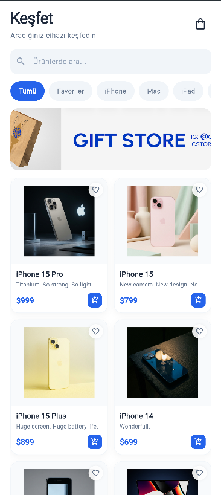
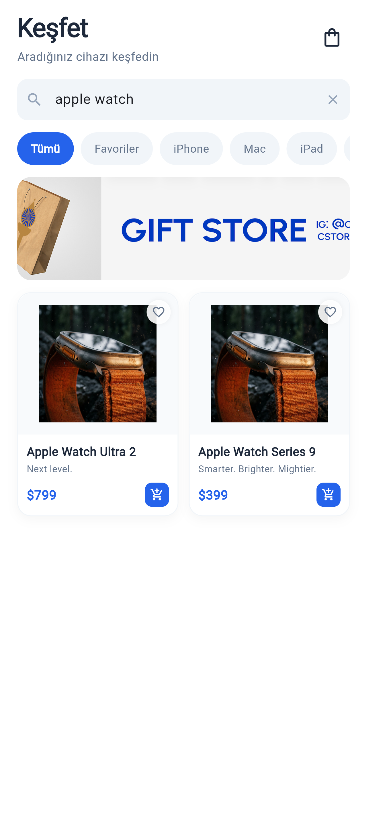
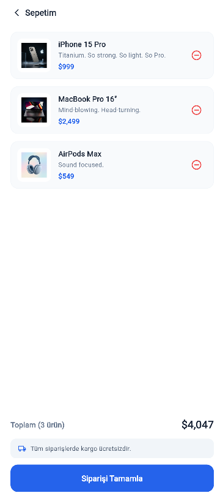
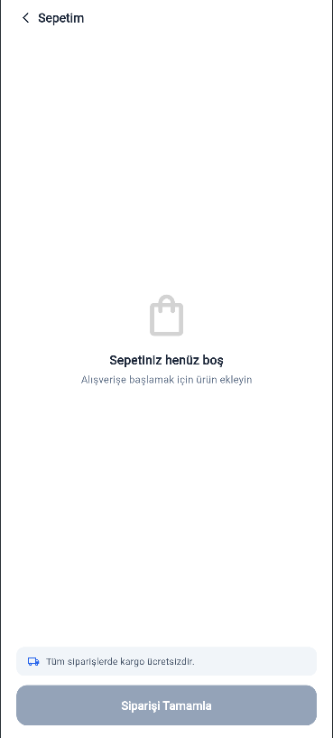

# Mini Katalog Uygulaması

Flutter ile geliştirilmiş; harici hiçbir üçüncü parti paket kullanılmadan yalnızca **Material 3** ve saf Dart bileşenleriyle inşa edilmiş, modern ve akıcı bir ürün kataloğu ve sepet simülasyonu mobil uygulamasıdır.

Bu proje, temel e-ticaret akışlarını, veri modellemesini (`JSON` ➔ `Model`), isimlendirilmiş rotalarla (`Named Routes`) sayfa geçişlerini ve yerleşik durum yönetimini (`setState`) temiz mimari prensiplerine sadık kalarak hayata geçirir.

---

## Ekran Görüntüleri

| 01. Keşfet (Ana Sayfa) | 02. Arama & Filtreleme | 03. Ürün Detayı | 04. Dolu Sepet | 05. Boş Sepet |
| :---: | :---: | :---: | :---: | :---: |
|  |  |  |  |  |

---

## Temel Özellikler

- **Yerel JSON Veri Akışı:** WantAPI ürün katalog verileri `assets/data/products.json` üzerinden `rootBundle` ile asenkron olarak okunur ve `Product` modeline dönüştürülür.
- **Katalog ve Izgara Görünümü (`GridView`):** Ürünler 2 sütunlu, responsive bir ızgara düzeninde listelenir; resimler, başlıklar, kısa sloganlar ve birim fiyatlar sunulur.
- **Anlık Arama & Kategori Filtreleme:** Arama çubuğu üzerinden ürün adı ve slogan bazında dinamik arama yapılabilir; yatay kategori çipleri (*Tümü, Favoriler, iPhone, Mac, iPad, Saat, Ses & Aksesuar*) ile tek dokunuşla filtreleme sağlanır.
- **Hızlı Sepete Ekleme & Rozet:** Ürün kartlarındaki hızlı ekle butonuyla ana sayfadan ayrılmadan sepete ürün eklenebilir; sağ üstteki sepet simgesinde toplam ürün sayısı anlık rozet (`Badge`) ile gösterilir.
- **Hero Görsel Animasyonu:** Liste ekranındaki ürün görselinden detay sayfasına geçişte akıcı `Hero` animasyonu kullanılır.
- **Detay Sayfası & Adet Kontrolü:** Route arguments üzerinden taşınan ürün bilgileri; dinamik teknik özellik kutuları (`specs`), detaylı açıklama metni ve adet seçici (`- 1 +`) ile zenginleştirilmiştir.
- **Sepet Simülasyonu:**
  - Sepetteki ürünlerin listelenmesi ve tek dokunuşla sepetten çıkarılması.
  - Sayısal fiyat parsing mantığıyla anlık dinamik **Toplam Tutar** hesabı.
  - Sepet boşaldığında otomatik olarak devreye giren bilgilendirici **Boş Durum (`Empty State`)** ekranı.
  - Sipariş onay penceresi (`AlertDialog`) ile satın alma simülasyonu.
- **Görsel Hata Toleransı:** Yerel görsel yükleme sorunlarına karşı `errorBuilder` koruması ve temiz yedek simgeler bulunur.
- **Sıfır Dış Bağımlılık:** Projede hiçbir harici paket (`http`, `provider`, `cached_network_image` vb.) kullanılmamış; tüm akış Flutter'ın yerleşik kütüphaneleriyle çözülmüştür.

---

## Proje Mimarisi

Uygulama klasör yapısı, sorumlulukların ayrılığı (*Separation of Concerns*) ilkesine uygun olarak modüler şekilde tasarlanmıştır:

```text
mini_catalog_app/
├── assets/
│   ├── data/
│   │   └── products.json          # 20 adet ürün verisini içeren katalog JSON'ı
│   └── images/
│       ├── banner.png             # Ana sayfa kampanya afişi
│       └── products/              # Yerel ürün görsel varlıkları (20 PNG)
├── lib/
│   ├── main.dart                  # Uygulama başlangıcı, tema ve rotalar
│   ├── models/
│   │   └── product.dart           # Null-safety uyumlu Product modeli (fromJson / toJson)
│   ├── services/
│   │   └── product_service.dart   # JSON okuma ve veri ayrıştırma servisi
│   ├── screens/
│   │   ├── home_screen.dart       # Keşfet, arama, kategori çipleri ve GridView
│   │   ├── detail_screen.dart     # Ürün detay sayfası ve adet seçici
│   │   └── cart_screen.dart       # Dolu ve boş sepet deneyimi
│   └── widgets/
│       ├── product_card.dart      # Yeniden kullanılabilir ürün kartı bileşeni
│       └── spec_box.dart          # Dinamik teknik özellik kutusu
├── screenshots/                   # Dokümantasyon ekran görüntüleri
├── test/
│   └── widget_test.dart           # Arayüz doğrulama birim testi
├── pubspec.yaml                   # Varlık ve proje konfigürasyonu
└── README.md
```

---

## Teknolojiler & Gereksinimler

- **Flutter SDK:** `>=3.13.0` (Geliştirme: `3.47.9 • channel stable`)
- **Dart SDK:** `>=3.13.7`
- **Hedef Platformlar:** Android, iOS, Web

---

## Kurulum ve Çalıştırma

Projeyi yerel ortamınızda çalıştırmak için aşağıdaki adımları takip edebilirsiniz:

1. **Depoyu klonlayın:**
   ```bash
   git clone https://github.com/fettahuskuplu/mini-catalog-app.git
   cd mini-catalog-app
   ```

2. **Bağımlılıkları yükleyin:**
   ```bash
   flutter pub get
   ```

3. **Uygulamayı çalıştırın:**
   - Bir emülatör veya bağlı fiziksel cihaz üzerinde:
     ```bash
     flutter run
     ```
   - Web üzerinde test etmek için:
     ```bash
     flutter run -d chrome
     ```

---

## Test ve Analiz

Kod kalitesini doğrulamak ve testleri çalıştırmak için:

```bash
# Statik kod analizi
dart analyze lib test

# Birim ve widget testleri
flutter test
```
